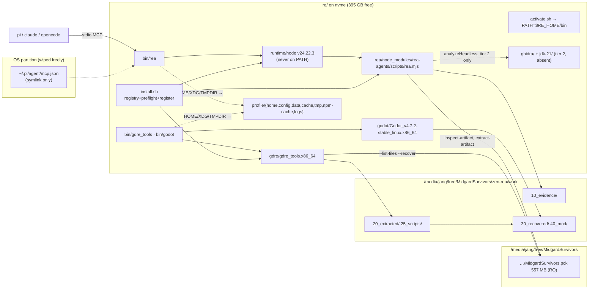

# ARCHITECTURE PLAN — Portable RE Environment: `morluto/rea` + GDRE Tools for Midgard Survivors

Slug: `portable-rea-re-env` · Draft v3 (post red-team) · host verified 2026-11-17

## 1. Summary

Stand up **one** wipe-proof tool tree — `/media/jang/home/PortableApp/re/` — that hosts REA
(`rea-agents`, an MCP tool server), GDRE Tools, and the Godot 4.7.2 editor, and point it at a
single target: `/media/jang/free/MidgardSurvivors/midgard-survivors-midgard-survivors-linux/`
(`MidgardSurvivors.pck` 557 MB, `GDPC` pack_format 4, `Godot Engine v4.7.2.stable.official`,
stripped `.x86_64` + two stripped GDExtension `.so`). The tree reuses the portable-env
convention already proven on this host for Go/Node/Rust (`go/portable.sh`,
`rust/activate.sh`, `rust/PROJECT_OVERVIEW.md`): tool tree + `profile/` state + `activate.sh` +
`portable.sh`, bootstrapped by an `env_re()` in
`/media/jang/home/Deve/zen-bashrc/src/01_env_suite.sh`. Two facts drive the whole design:
REA hard-refuses to run on this host's portable Node 24.11.0 (engine gate enforced in code, not
metadata), and REA resolves its own state root from `$HOME`. Both are solved by shipping a
pinned Node inside the tree and by launching every tool through a wrapper that re-points
`HOME`/`XDG_*`/`TMPDIR` onto the data partition — so after an OS wipe, `source activate.sh` +
`install.sh --register` restores a working environment with nothing lost. Analysis of the
target's actual contents (thousands of `.gdc` + `.remap`, `project.binary`, `.godot/…/*.ctex`)
confirms REA's built-in PCK reader is *not* sufficient (inventory/extraction only, no
`gdsdecomp` backend), so GDRE Tools is the decompiler and REA is the evidence/inventory layer.

## 2. Verified host facts (every decision below traces to one of these)

| Fact | Evidence |
| --- | --- |
| Portable Node = `v24.11.0` (`/media/jang/home/PortableApp/node/bin/node`), npm 11.9.0, `NPM_CONFIG_PREFIX=$NODEDIR/profile/npm-global` | `node -v`, `npm config ls -l`, `enva.sh` |
| REA engine gate `"^22.23.4 \|\| ^24.22.1 \|\| >=26.12.1"` **enforced at runtime** → current host Node is refused | npm `engines` + live `rea.mjs` run printed the refusal and exited |
| Newest Node satisfying the gate = `v24.22.3`; `SHASUMS256.txt` published | `https://nodejs.org/dist/index.json`; sha256 `4f2b175a…6fcfb` for `node-v24.22.3-linux-x64.tar.xz` |
| `rea-agents@6.9.0` = `dist-tags.latest`; `bin {rea, rea-agents}`; 42 prod deps, all also `bundleDependencies`; `npm-shrinkwrap.json` shipped; unpacked ≈181 MiB (208 MB on disk); only non-bundled optional dep is `frida` (`hasInstallScript`) | registry metadata + extracted tarball |
| No LLM API key: REA is a pure MCP tool server; ships its own `mcp.json` (`npx -y rea-agents@6.9.0 mcp`) | `dist/config/environment.js`, tarball `mcp.json` |
| REA state root `~/.rea/{cache,state}` is resolved from `process.env.HOME`/`USERPROFILE` — **no `REA_HOME`, but `$HOME` is honoured** | `src/config/homeDirectory.ts`, `dist/application/Uninstall.js:315,782,811` |
| REA backends are all optional and located by stock env vars: `GHIDRA_INSTALL_DIR`, `JAVA_HOME`, `REA_RIZIN_COMMAND`, `REA_OBJDUMP_COMMAND`, `REA_KUNA_CACHE_DIR`, `REA_BINWALK_COMMAND` … | `docs/design/rea-limit-inventory.md:146-213` |
| REA's Godot PCK support = internal reader, formats 1–4, inventory + extraction, encrypted members flagged not decrypted; **no `gdre_tools`/`gdsdecomp` backend** | `docs/godot-pck.md`; grep `dist/ bridge/ scripts/` → 0 hits |
| REA requires procps `ps` even for static lanes; `prlimit` for several lanes | REA docs; `command -v` sweep |
| `pi` reads user MCP servers from `~/.pi/agent/mcp.json` (`mcpServers` shape) and validates with `pi mcp list`, which **exits 1 if an enabled server is not connected** | `@earendil-works/pi-coding-agent/docs/mcp.md:32,38-56,96` |
| `~/.pi/agent/{settings,models}.json` are symlinks into `/media/jang/home/Deve/harness-configs/config-pi/`; `mcp.json` does not exist there or in `~/.pi/agent/` | `ls -la` |
| `~/.claude.json`, `~/.cursor/mcp.json`, `~/.config/zed/settings.json`, `~/.rea`, `~/.cache/rea` **do not exist** on this host | `ls` |
| GDRE Tools latest `v2.7.4`; `GDRE_tools-v2.7.4-linux.zip` = 35,295,754 B, flat 3-file layout (`gdre_tools.x86_64` 63 MB, `gdre_tools.pck` 6.5 MB, `libGodotMonoDecompNativeAOT.so` 24 MB ≈ 94 MB unpacked); **no upstream checksum asset (404)** → digest pinned by us: `3dc4f1244dda62e41e0c952ac00a69e60e07f3b0d5a211164806bf9d41a54758` | GitHub API + download + `sha256sum` |
| `gdre_tools.x86_64 --headless --gdre-version` → `Godot RE Tools v2.7.4`; `--list-files=<pck>` lists the whole archive; CLI contract `--headless --recover|--extract|--list-files=<PCK> [--output=DIR] [--scripts-only] [--force-bytecode-version=]` | live run on the target PCK + GDRE README:44-113 |
| Godot/GDRE writes `$XDG_DATA_HOME/godot/app_userdata` (seen with `HOME=/tmp/fakehome`) | live run |
| Game = Godot `4.7.2-stable`; latest Godot release = `4.7.2-stable`; checksums only via per-tag `SHA512-SUMS.txt` (`Godot_v4.7.2-stable_linux.x86_64.zip` = `9aa00f7a…1b14`) | `strings` on the exe + GitHub API + that file |
| Target PCK contains `res://scripts/**/*.gdc` + matching `.gd.remap`, `res://scenes/main.tscn.remap`, `res://project.binary`, `res://.godot/extension_list.cfg`, `res://eos/credentials.cfg`, `res://locale/*.po`, thousands of `.ctex`/`.import` | `--list-files` capture |
| Temurin 21 = `21.0.13+9`, checksum file is `…tar.gz.sha256.txt` (`d7f5d5cf…66d1c`); host JDK is 17 (too old for Ghidra 12.x) | adoptium API |
| Ghidra assets: `12.1.4_PUBLIC_20260921.zip` (200) — no glob in download paths; digest published in the release body, not as an asset | `curl -fsIL` + GitHub API |
| Host tools present: `ps prlimit objdump readelf strings tar unzip xz jq gdb curl`; absent: `7z rizin tshark`; glibc 2.44, x86_64 | `command -v`, `ldd --version` |
| Disk: `/media/jang/free` (sdb3, 24 G) **4,917 MB free**, game = 631 MB; `/media/jang/home` (nvme, 916 G) **403,771 MB free** | `df -B1M` |
| `env_active()` is at `01_env_suite.sh:4`, its locals at 5-13 (`BASEDIR` line 8), the Rust guard at **31-33**, `__env_body()` at **55**, `env_rust()` at **261** | `grep -n` |
| `stitch.sh` writes `zen-bashrc/bashrc` and only *warns* if `~/.bashrc` doesn't resolve to it; it never writes `~/.bashrc` (which is a symlink here) | `stitch.sh:8,21,37-45` |
| `env_register` lifts `env_active()` from the **running shell** (`declare -F` guard) → stale registration risk; supports `-n` dry run | `01_env_suite.sh:55-140` |

## 3. System boundaries and components

Three zones with exactly one write-path each:

| Zone | Path | Owner | Contents |
| --- | --- | --- | --- |
| **ENV** (tools, wipe-proof) | `/media/jang/home/PortableApp/re/` | `install.sh` | pinned runtimes, `rea`, `gdre`, `godot`, `profile/` state |
| **TARGET** (read-only inputs) | `/media/jang/free/MidgardSurvivors/midgard-survivors-midgard-survivors-linux/` | user | never written, ever |
| **WORK** (durable outputs) | `/media/jang/free/MidgardSurvivors/zen-rea/work/` | REA + GDRE + Godot | evidence JSON, extracted members, recovered project, `40_mod` git repo |
| **OS partition** | `$HOME` | — | exactly one symlink: `~/.pi/agent/mcp.json` (and nothing else, enforced by `verify.sh`) |



### 3.1 `install.sh` internal component map

```
re/
├── install.sh              registry + downloader + installer + preflight + register   ← only entry point
├── activate.sh             PATH for wrappers + RE_WORK; sources nothing else
├── portable.sh, brc*       isolated subshell (parity with go/ and rust/)      *brc generated
├── verify.sh               acceptance harness; writes profile/logs/verify.json
├── PROJECT_OVERVIEW.md     hand-off doc for a future session
├── bin/rea  bin/gdre_tools  bin/godot     per-process HOME/XDG/TMPDIR redirects
├── dist/<file> .part .lock installed.json*  retained downloads (offline reinstall)
├── runtime/node/           pinned Node v24.22.3
├── rea/node_modules/rea-agents/            npm --prefix install target
├── gdre/  godot/           tier-1 binaries
├── jdk-21/  ghidra/        tier-2, absent by default
└── profile/home .config .data .cache .tmp .npm-cache .logs   ← the fake $HOME everything writes into
```

```
zen-rea/work/                      ← inside the project tree (user decision D7)
├── 10_evidence/   rea inspect-artifact --evidence_output  (timestamped names)
├── 20_extracted/  gdre_tools --extract           raw members
├── 25_scripts/    gdre_tools --scripts-only --recover   .gd sources only (fast, cheap)
├── 30_recovered/  gdre_tools --recover           full runnable project
├── 40_mod/        git init'd copy of 30_recovered — the thing we edit
└── logs/          pck-files.txt, install.log, verify.json, verify.baseline.json
```

## 4. Data flow and state

### 4.1 Two-phase first run (the only path that touches the target)

```mermaid
sequenceDiagram
  participant A as Agent (pi)
  participant W as re/bin/rea
  participant G as re/bin/gdre_tools
  participant P as MidgardSurvivors.pck (RO)
  participant K as zen-rea/work
  A->>W: inspect-artifact PCK --detail summary --evidence_output 10_evidence/pck-<ts>.json
  W->>P: read GDPC header + index (no Godot, no run)
  W->>K: evidence JSON (new file; REA never overwrites → timestamped name)
  A->>G: --headless --list-files=PCK > logs/pck-files.txt
  G->>P: read index
  A->>G: --headless --scripts-only --recover=PCK --output=25_scripts
  G->>K: .gd sources, project.godot, recovery log
  A->>G: --headless --recover=PCK --output=30_recovered   (space-gated, big)
  G->>K: full project (.tscn/.tres/.ctex→sources)
  A->>A: cp -a 30_recovered 40_mod && git init (modding happens only in 40_mod)
```

### 4.2 State ownership (who owns what mutable byte)

| State | Canonical file | Written by | Read by | Recreated by |
| --- | --- | --- | --- | --- |
| Pinned versions + digests | `re/install.sh` `case` block (in-tree registry) | human, at pin time | `acquire`, `run_probe` | edit + `install.sh --force --only=name` |
| Installed-artifact record | `re/dist/installed.json` | `install.sh install_artifact` | `artifact_present`, `verify.sh` | re-run install |
| REA process state (`~/.rea/cache`, `state`) | `re/profile/home/.rea/` | REA (via wrapper's `HOME`) | REA | automatic |
| Godot/GDRE user data, editor `.godot/` caches | `re/profile/data/godot/`, project-local `.godot/` | GDRE/Godot (via wrapper) | Godot editor | automatic |
| Scratch (provider sandboxes, extraction staging) | `re/profile/tmp/` (`TMPDIR`) | REA `mkdtemp`, GDRE | tools | free-form, safe to purge |
| Ground-truth baselines (PCK file count, tool count) | `zen-rea/work/logs/verify.baseline.json` | `verify.sh --capture` | `verify.sh` | re-capture after a deliberate change |
| MCP registration | `harness-configs/config-pi/mcp.json` | `install.sh --register` | `pi` | re-run `--register` |

Rule: **no mutable state anywhere except `re/profile/`, `re/dist/installed.json`, and the work
tree.** `re/runtime`, `re/rea`, `re/gdre`, `re/godot` are treated as immutable after install —
which is what makes `--force` reinstall safe.

## 5. Implementation Blueprint

Shell "signatures" are contracts: name, args, stdout/exit codes — bodies are `# TODO` and the
algorithm is the prose under each row.

| # | File path | Action | Concrete signature / schema | Depends on | Acceptance ("done when") |
| --- | --- | --- | --- | --- | --- |
| 1 | `re/` tree (`profile/home`, `profile/config`, `profile/data`, `profile/cache`, `profile/tmp`, `profile/npm-cache`, `profile/logs`, `bin`, `dist`, `runtime`, `rea`, `gdre`, `godot`) | create | explicit `mkdir -p` list, **no brace expansion** (scripts are `#!/bin/sh`; `/bin/sh → bash` here would mask the difference) | — | `ls -d` on each of the 11 paths succeeds; `stat -c %a re/bin` ≥ 755; `find re -maxdepth 1 -name '*{*'` empty |
| 2 | `re/install.sh` | create | `install.sh [--tier=N] [--only=name[,name]] [--dry-run] [--force] [--register] \| preflight` — subcommand-less = install. Internal contract:<br>`art_field(name,field) -> string` (`case "$name" in` table, §5.1)<br>`artifact_present(name) -> 0/1`<br>`acquire(name)` → `dist/<file>.part` → digest check → `mv` into `dist/`<br>`extract_artifact(name)` → `tar -x[a]Jzf --strip-components=N` \| `unzip -o` into `re/<dir>` + `chmod +x`<br>`npm_install_rea()`<br>`run_probe(name)`<br>`preflight()`<br>`register()`<br>`main()` with `mkdir "$(dirname "$0")/dist/.lock"` trap-based mutex | 1 | `install.sh --dry-run --tier=1` prints 4 planned actions and writes **no** files (`find re -newer <stamp>` = `install.sh` only); second run of any subcommand is a no-op (`artifact_present` true, `up to date`) |
| 3 | `re/install.sh` `preflight()` | create | checks → `profile/logs/preflight.json`<br>`{ok:bool, arch:str, glibc:str, host:{ps:str,prlimit:str,tar:str,unzip:str,xz:str,curl:str}, nodePinned:str|null, nodeShared:str, reaGateOk:bool, mounts:{reWritable:bool, targetReadable:bool}, space:{workAvailMb:int, neededMb:int}, failures:[{code,msg,fix}]}`; exit 0 = pass, 1 = any `failures[].code` | 1 | exits 0 on this host with `nodePinned:null` (absent ≠ failure); exits 1 with `code=HOST_TOOL_MISSING` when `PATH` is emptied of `unzip`; gate computed **only** from `runtime/node/bin/node --version` vs `"^22.23.4 \|\| ^24.22.1 \|\| >=26.12.1"` |
| 4 | `re/runtime/node/` | create (tier 0) | `art_field(node,url)="https://nodejs.org/dist/v24.22.3/node-v24.22.3-linux-x64.tar.xz"`, `(node,digestMode)="sha256"`, `(node,digest)="4f2b175a6d53a5c617a80dba2676238a0688cef28c6da4eba35c7d844e66fcfb"`, `(node,extractTo)="runtime/node"`, `(node,strip)=1`, `(node,probe)="runtime/node/bin/node --version"` | 2,3 | `runtime/node/bin/node -v` = `v24.22.3`; `which node` **still** resolves to the shared `PortableApp/node/bin/node` (we never add it to `PATH`) |
| 5 | `re/rea/` (`package.json`, `node_modules/rea-agents/`) | create (tier 0) | `npm_install_rea()`: `env -u NPM_CONFIG_PREFIX -u NPM_CONFIG_USERCONFIG NPM_CONFIG_CACHE=$RE_HOME/profile/npm-cache npm install --prefix "$RE_HOME/rea" --global=false --engine-strict=false --omit=optional --no-audit --no-fund rea-agents@6.9.0` | 2,3,4 | `test -f re/rea/node_modules/rea-agents/scripts/rea.mjs`; `test ! -e /media/jang/home/PortableApp/node/profile/npm-global/bin/rea`; `ls re/rea/node_modules/rea-agents/node_modules \| wc -l` ≥ 42 — **as-built: 128**. The top-level dir holds only `rea-agents` (npm does not hoist `bundleDependencies`); `test ! -d re/rea/node_modules/frida` |
| 6 | `re/bin/rea` | create | `#!/bin/sh`:<br>`RE_HOME=$(cd -- "$(dirname -- "$0")/.." && pwd)`<br>`export HOME="$RE_HOME/profile/home"` (REA resolves `~/.rea` from `$HOME`)<br>`export XDG_CONFIG_HOME/XDG_DATA_HOME/XDG_CACHE_HOME=$RE_HOME/profile/{config,data,cache}`<br>`export TMPDIR=$RE_HOME/profile/tmp`<br>`export REA_KUNA_CACHE_DIR=$RE_HOME/profile/cache/rea/kuna`<br>`export REA_LOG_LEVEL=${REA_LOG_LEVEL:-warn}`<br>`if [ -x "$RE_HOME/ghidra/support/analyzeHeadless" ] && [ -x "$RE_HOME/jdk-21/bin/java" ]; then export GHIDRA_INSTALL_DIR=$RE_HOME/ghidra JAVA_HOME=$RE_HOME/jdk-21; fi`<br>`exec "$RE_HOME/runtime/node/bin/node" "$RE_HOME/rea/node_modules/rea-agents/scripts/rea.mjs" "$@"`<br>`chmod +x` | 4,5 | `rea --version` = `6.9.0` (no runtime refusal); `test ! -e "$HOME/.rea"`; `rea --json` output lands in `re/profile/home/.rea/`; `rea setup --dry-run --json` **never run without `--dry-run`** (see §7 row F-REG) |
| 7 | `re/install.sh --register` | create | `register()`: regenerate `harness-configs/config-pi/mcp.json` from live `$RE_HOME` (same pattern as `rust/portable.sh` regenerating `brc`), then re-link `~/.pi/agent/mcp.json` → that file. `link(dir,src)`: `[ -L d ] && correct || { [ -e d ] && [ ! -L d ] && mv d d.pre-re.$(date +%s); ln -s src d; }` — never `ln -sfn` onto a directory (GNU coreutils nests the link inside it) | 6 | `cat $(readlink -f ~/.pi/agent/mcp.json)` shows the wrapper path; `pi mcp list` prints the `rea` server with tools and exits **0**; `test ! -e ~/.claude.json ~/.cursor/mcp.json ~/.config/zed/settings.json` (they must stay nonexistent) |
| 8 | `/media/jang/home/Deve/harness-configs/config-pi/mcp.json` | create | `{"mcpServers":{"rea":{"command":"/media/jang/home/PortableApp/re/bin/rea","args":["mcp"],"description":"Reverse Engineer Anything — static/dynamic binary + PCK analysis"}}}`; no `env` block (env lives in the wrapper, so CLI and MCP share one source of truth) | 6,7 | `jq -e '.mcpServers.rea.command|endswith("/re/bin/rea")'` and the file is inside the git-managed `harness-configs` repo (`git -C … rev-parse --is-inside-work-tree`) |
| 9 | `re/gdre/` | create (tier 1) | `art_field(gdre,url)="…/v2.7.4/GDRE_tools-v2.7.4-linux.zip"`, `(gdre,digestMode)="sha256(pinned, no upstream)"`, `(gdre,digest)="3dc4f1244dda62e41e0c952ac00a69e60e07f3b0d5a211164806bf9d41a54758"`, `(gdre,extractTo)="gdre"`, `(gdre,unpack)="unzip"`, `(gdre,probe)="gdre_tools.x86_64 --headless --help" — **as-built**: `--gdre-version` prints the right string but *exits 1* by upstream design, which would make `run_probe` fail forever` | 2,3 | `run_probe` output string-equals `Godot RE Tools v2.7.4`; 3 files present incl. `gdre_tools.pck` (must stay beside the binary); `chmod +x gdre/gdre_tools.x86_64` |
| 10 | `re/godot/` | create (tier 1) | `art_field(godot,url)="https://github.com/godotengine/godot/releases/download/4.7.2-stable/Godot_v4.7.2-stable_linux.x86_64.zip"`, `(godot,digestMode)="sha512-grep"`, `(godot,checksumUrl)="…/4.7.2-stable/SHA512-SUMS.txt"`, `(godot,digest)="9aa00f7a…e150c59ed54c65"`, `(godot,probe)="Godot_v4.7.2-stable_linux.x86_64 --headless --version"` | 2,3 | probe prints `4.7.2.stable.official.ed1daf0bf` — **as-built**: editor builds append the tag commit (`ed1daf0bf` = `git ls-remote` for tag `4.7.2-stable`) while the game reports `4.7.2.stable.official`; same version, strict string equality kept |
| 11 | `re/bin/gdre_tools`, `re/bin/godot` | create | `#!/bin/sh`, same `RE_HOME`-from-`$0` derivation + `HOME`/`XDG_*`/`TMPDIR` exports as row 6, then `exec "$RE_HOME/gdre/gdre_tools.x86_64" --headless "$@"` / `exec "$RE_HOME/godot/Godot_v4.7.2-stable_linux.x86_64" "$@"`. **No `--path=`** (not a GDRE standalone flag; `--path` belongs to an engine build, GDRE README:168) | 9,10 | `HOME=/tmp/probe-home.$(date +%s) gdre_tools --headless --gdre-version` → v2.7.4 **and** `find /tmp/probe-home.* -type f` is empty; `test -e ~/.local/share/godot` still false |
| 12 | `/media/jang/free/MidgardSurvivors/zen-rea/work/{10_evidence,20_extracted,25_scripts,30_recovered,40_mod,logs}` (inside the project tree, per user) | create | numbered dirs (order = pipeline stage, so `du -sh 20_extracted` is an unambiguous gate input); `40_mod/.gitignore` = `.godot/\n*.tmp\nexport_credentials.cfg\neos/credentials.cfg`; `git init 40_mod` | 11, §5 row 3 (space) | `du -sh` works on all six; `git -C 40_mod status` clean-empty; `TARGET` dir untouched (`find /media/jang/free/MidgardSurvivors/midgard-survivors-midgard-survivors-linux -newer re/bin/rea` empty) |
| 13 | First-run smoke (documented command block in `re/PROJECT_OVERVIEW.md`, run manually) | run | `rea inspect-artifact <PCK> --detail summary --evidence_output $WORK/10_evidence/pck-$(date +%Y%m%dT%H%M%S).json --json`<br>`gdre_tools --headless --list-files=<PCK> > $WORK/logs/pck-files.txt`<br>`gdre_tools --headless --scripts-only --recover=<PCK> --output=$WORK/25_scripts`<br>`gdre_tools --headless --recover=<PCK> --output=$WORK/30_recovered`<br>`--evidence_output` **never overwrites** → timestamped filename is mandatory for re-runnability; `--scripts-only` deliberately excludes scenes/resources, so the scene assertion belongs to the full `--recover` only | 6,7,11,12 | `10_evidence/pck-*.json` parses (`jq .`), `pck-files.txt` non-empty, `25_scripts` contains `project.godot` + ≥1 `*.gd`, `30_recovered/scenes/main.tscn` exists (derived from `res://scenes/main.tscn.remap`) |
| 14 | `re/verify.sh` | create | `verify.sh [--capture|--json|--brief]`; checks: `check_node` `check_rea` `check_mcp_handshake` `check_gdre` `check_godot` `check_registration` `check_home_pollution` `check_pinned_absence`. Each check appends `{name,ok,got,want}` to `profile/logs/verify.json`; **script exits non-zero on any failure, independent of the JSON** (no circular pass). Ground truth lives in `$WORK/logs/verify.baseline.json` = `{nodeVersion:"v24.22.3", reaVersion:"6.9.0", reaToolCount:int, gdreVersion:"Godot RE Tools v2.7.4", godotVersion:"4.7.2.stable", pckFileCount:int}` captured by `--capture` immediately after step 13, then treated as a floor. **As-built:** a global `find $HOME -newer` is unachievable (unrelated desktop apps write there mid-session, observed) — `check_pinned_absence` uses an explicit allowlist that must stay ABSENT (`~/.rea`, `~/.cache/rea`, `~/.npm`, `~/.config/godot`, `~/.claude.json`, `~/.cursor/mcp.json`, `~/.config/zed/settings.json`, `~/.local/share/godot/app_userdata/Godot RE Tools`) while `profile/data/godot/app_userdata/Godot RE Tools` must EXIST. `check_target_integrity` adds a sha256 comparison of the read-only PCK against the baseline | 13 | `verify.sh --json; echo $?` → 0 on a good tree; deliberately deleting `runtime/node` makes it exit 1 (proves the check isn't self-certifying) |
| 15 | `re/activate.sh` | create | `# source-only, idempotent, silent; return 1 if not installed`<br>`__re_home="$(cd -- "$(dirname -- "${BASH_SOURCE[0]:-$0}")" && pwd)"`<br>`[ -x "$__re_home/bin/rea" ] \|\| return 1`<br>`export RE_HOME="$__re_home"`<br>`export RE_WORK="/media/jang/free/MidgardSurvivors/zen-rea/work"`<br>`case ":$PATH:" in *":$RE_HOME/bin:"*) ;; *) export PATH="$RE_HOME/bin:$PATH" ;; esac`<br>Deliberately **not** exported: `JAVA_HOME`, `GHIDRA_INSTALL_DIR`, `XDG_*`, `TMPDIR`, `NODE_HOME`, `HOME` — all per-process, all owned by the wrappers | 6,11 | sourcing twice adds one `PATH` entry total; `node -v` still `v24.11.0`; `rea --version`, `gdre_tools --headless --gdre-version`, `godot --headless --version` all resolve via `re/bin` |
| 16 | `re/portable.sh` + generated `re/brc` | create | mirror `rust/portable.sh`, but fix the known `PS1` bug (`echo "export PS1='… $PS1'"` evaluates with `PS1` unset in a non-interactive script → the subshell loses the prompt instead of prefixing it). Generate instead:<br>`{ echo "# generated by portable.sh - do not edit"; echo "source \"$THIS_DIR/activate.sh\""; echo "PS1='[portable-re] '\"$PS1"; } > "$THIS_DIR/brc"`<br>then `exec bash --rcfile "$THIS_DIR/brc" -i` | 15 | `./portable.sh` lands in an interactive shell whose prompt begins `[portable-re] ` **and** still contains the original prompt tail; `command -v rea` = `$RE_HOME/bin/rea` |
| 17 | `/media/jang/home/Deve/zen-bashrc/src/01_env_suite.sh` | modify | (a) locals block (lines 5-13): add `local REDIR="$BASEDIR/re"` next to `RUSTDIR` (line 8 neighbours). (b) after the Rust guard (lines 31-33), same `[ -d ]`-guarded shape:<br>`if [ -x "$REDIR/bin/rea" ]; then . "$REDIR/activate.sh"; fi`<br>(c) new `env_re()` after `env_rust()` (line 261):<br>`env_re() { local BASEDIR=…/PortableApp; local REDI=$BASEDIR/re; local TIER="${1:-1}"; "$REDI/install.sh" preflight \|\| return 1; "$REDI/install.sh" --tier="$TIER" \|\| return 1; "$REDI/install.sh" --register \|\| return 1; . "$REDI/activate.sh" \|\| return 1; "$REDI/verify.sh" --brief; }`<br>Constraint: `env_active()`'s body is lifted verbatim by `__env_body()` (line 55) into `enva.sh` → plain assignments + `if` only, no function definitions, no `local`-only constructs | 15 | `grep -c 'REDIR' src/01_env_suite.sh` ≥ 3; `declare -F env_re` succeeds after reload |
| 18 | `zen-bashrc/bashrc` + `zen-bashrc/enva.sh` + `/etc/profile.d/custom_env.sh` | regenerate | `cd /media/jang/home/Deve/zen-bashrc && ./stitch.sh && . ./bashrc && envr -n && envr`. `stitch.sh` writes the repo `bashrc` (which `~/.bashrc` symlinks to — it never writes `~/.bashrc` itself); re-sourcing first is **required** because `env_register` lifts `env_active()` from the *running* shell, and `envr -n` previews without touching `/etc` (the current symlink is already correct, so no `sudo` path is taken) | 17 | `diff <(declare -f env_active) /dev/null >/dev/null` not needed — assert directly: `grep -n 'REDIR/activate.sh' enva.sh` non-empty and `readlink /etc/profile.d/custom_env.sh` unchanged |
| 19 | `re/PROJECT_OVERVIEW.md` | create | sections copied from `rust/PROJECT_OVERVIEW.md` shape: purpose · why pinned-Node-in-tree (engine gate) · key entry points (`install.sh`/`activate.sh`/`bin/*`/`verify.sh`) · layout with `du -sh`-measured sizes · the three commands to run against the target · **"after an OS wipe"** procedure (`source activate.sh` → `install.sh --register` → `verify.sh`) · prohibitions (`rea setup` without `--dry-run`, `pi mcp add`, `rea update`) | 18 | a fresh agent can restore MCP registration with only this file open; measured sizes present (not estimates) |
| 20 | `re/jdk-21/`, `re/ghidra/` | create **only on demand** (tier 2) | `art_field(jdk21,url)="…/jdk-21.0.13%2B9/OpenJDK21U-jdk_x64_linux_hotspot_21.0.13_9.tar.gz"`, `digestMode sha256-grep`, `checksumUrl="…tar.gz.sha256.txt"` (note the `.txt` suffix — the extension-less variant 404s), `digest="d7f5d5cf865a2902b70ff549b97586a7d3f234e016f041ab447ea740c7d66d1c"`, `extractTo="jdk-21"`, `strip=1`; `art_field(ghidra,url)="…/Ghidra_12.1.4_build/ghidra_12.1.4_PUBLIC_20260921.zip"`, `digest` captured from that release's body (`SHA-256:` line) at enablement time, `extractTo="ghidra"`, `strip=1` | 14 | `install.sh --tier=2` then `JAVA_HOME=$RE_HOME/jdk-21 $RE_HOME/ghidra/support/analyzeHeadless -h` prints usage (exit 0). If it reports an unsupported JDK, flip the pair to 12.2 + Temurin 25 in the registry — the pairing claim (12.1.4↔21, 12.2↔25) comes from REA docs and is treated as unverified until this command runs |

### 5.1 In-tree artifact registry (lives inside `install.sh`, not a separate file)

```sh
# art_field <name> <field> -> value.  Digests are PINNED LITERALS, not remote checksum files:
# three of the four "obvious" upstream checksum URLs 404 on this toolset (verified), and a
# pinned digest is stronger anyway (no network, no asset-name drift).
art_field() {
  case "$1:$2" in
    node:url)  echo https://nodejs.org/dist/v24.22.3/node-v24.22.3-linux-x64.tar.xz ;;
    node:digestMode) echo sha256 ;;  node:digest) echo 4f2b175a…6fcfb ;;  # + extractTo/strip/probe
    rea:url)   echo "" ;;            rea:npmSpec) echo rea-agents@6.9.0 ;; # bundleDependencies + shrinkwrap published
    gdre:url)  echo https://github.com/GDRETools/gdsdecomp/releases/download/v2.7.4/GDRE_tools-v2.7.4-linux.zip ;;
    gdre:digestMode) echo sha256 ;;  gdre:digest) echo 3dc4f124…4758 ;;
    godot:url) echo https://github.com/godotengine/godot/releases/download/4.7.2-stable/Godot_v4.7.2-stable_linux.x86_64.zip ;;
    godot:digestMode) echo sha512 ;; godot:digest) echo 9aa00f7a…1b14 ;;
    jdk21:*)   # tier 2 ;;   ghidra:*) # tier 2, digest captured at enablement
  esac
}
```
`run_probe(name)` compares the probe's version string to the registry pin and fails on
inequality — otherwise a mis-pinned artifact silently "passes".

**Verbatim digest block** (copy into the `case` table; each value was captured on this host on
2026-11-17 from the official source named, so `install.sh` needs no network to verify):

```sh
# node   v24.22.3  linux-x64.tar.xz            sha256  4f2b175a6d53a5c617a80dba2676238a0688cef28c6da4eba35c7d844e66fcfb  <- nodejs.org/dist/v24.22.3/SHASUMS256.txt
# godot  4.7.2-stable linux.x86_64.zip         sha512  9aa00f7a605200940bce3027a567b782f49bd8e940dd06ae9e987bd65aee1b1467edd56ed84fcdcbdd44354bf613bdbb4e5d2913e925850368e150c59ed54c65  <- godot releases 4.7.2-stable/SHA512-SUMS.txt
# jdk21  21.0.13+9  jdk_x64_linux_hotspot .tar.gz sha256 d7f5d5cf865a2902b70ff549b97586a7d3f234e016f041ab447ea740c7d66d1c  <- temurin21 …tar.gz.sha256.txt
# gdre   v2.7.4     GDRE_tools-linux.zip       sha256  3dc4f1244dda62e41e0c952ac00a69e60e07f3b0d5a211164806bf9d41a54758  <- self-pinned (GDRE publishes no checksum asset)
# ghidra 12.1.4      ghidra_12.1.4_PUBLIC_20260921.zip  sha256 <capture from that release's body "SHA-256:" line at tier-2 enablement>
```

## 6. Ordered, atomic build sequence

Each row is hand-offable alone: it names what to touch, what to write, and how to know it is
done. Steps 1-6 = "REA usable as an MCP server"; 7-13 = "the game is decompiled".

| # | Step (files) | Depends | Acceptance gate |
| --- | --- | --- | --- |
| 1 | Create explicit dir tree (row 1) | — | 11 `ls -d` probes succeed; no brace-literal dirs |
| 2 | Write `install.sh`: registry + `artifact_present` + `acquire` + `extract_artifact` + `run_probe` + `.lock` mutex (rows 2, 5.1) | 1 | `--dry-run --tier=1` lists exactly `node, rea, gdre, godot`; writes nothing; re-run identical output |
| 3 | Add `preflight()` (row 3) | 1 | `preflight` → exit 0, `profile/logs/preflight.json` parses, `nodePinned:null` is **not** a failure |
| 4 | `install.sh --only=node` (row 4) | 2,3 | `runtime/node/bin/node -v` = `v24.22.3`; `dist/` holds the `.tar.xz` + `installed.json` records its digest |
| 5 | `install.sh --only=rea` (row 5) | 4 | `rea.mjs` exists under `re/rea/`; **`$NODEDIR/profile/npm-global/bin/rea` does not exist** (the whole point of the step) |
| 6 | Write `bin/rea` + `verify` of state redirection (row 6) | 5 | `rea --version` = 6.9.0; `ls re/profile/home/.rea/` shows `cache state`; `test ! -e ~/.rea` |
| 7 | `install.sh --register` + `mcp.json` (rows 7,8) | 6 | `pi mcp list` shows `rea` connected with tools, exit 0; the three foreign client configs still nonexistent |
| 8 | `install.sh --only=gdre,godot` (rows 9,10) | 2,3 | `run_probe` string-equality on `Godot RE Tools v2.7.4` and `4.7.2.stable`; probes ran with `HOME`/`XDG_*` redirected, so `~/.local/share/godot` still absent |
| 9 | Write `bin/gdre_tools`, `bin/godot` (row 11) | 8 | probe run leaves `/tmp/probe-home.*` empty |
| 10 | Work tree in the project (row 12) | 3 | `preflight` emits advisory `WORK_SPACE_LOW` (exit stays 0) when free space < the as-built basis (`2 × du(30_recovered)`, else `4 × du(PCK)`); `3 × du(20_extracted)` was degenerate — that dir stays empty — so the gate could never fire; TARGET dir mtime-untouched |
| 11 | Smoke run (row 13) | 6,7,9,10 | `project.godot` + ≥1 `.gd` in `25_scripts`; `30_recovered/scenes/main.tscn` exists; `pck-files.txt` non-empty |
| 12 | `verify.sh --capture` then `verify.sh --json` (row 14) | 11 | `verify.baseline.json` written with the measured `pckFileCount` and `reaToolCount`; `verify.sh` exits 0; deliberately breaking `runtime/node` makes it exit 1 |
| 13 | `activate.sh` + `portable.sh` + `brc` (rows 15,16) | 6,9 | double-source idempotent; shared `node -v` unchanged; subshell prompt `[portable-re] …` |
| 14 | `01_env_suite.sh` edits → `stitch.sh` → `. ./bashrc` → `envr -n` → `envr` (rows 17,18) | 13 | fresh login shell: `command -v rea` = `…/re/bin/rea`, `enva` prints no error, `enva.sh` contains the `REDIR` block |
| 15 | `PROJECT_OVERVIEW.md` with measured sizes (row 19) | 14 | `du -sh re/*` numbers in the doc; wipe-recovery procedure ≤ 3 commands |
| 16 | *(conditional)* `install.sh --tier=2` (row 20) | 12 | `analyzeHeadless -h` succeeds with `JAVA_HOME` set from the wrapper |

## 7. Failure modes → guarding file/function

| ID | Failure | Guard (file → function) | Detection |
| --- | --- | --- | --- |
| F-NODE | REA refuses to start: host/portable Node 24.11.0 ∉ `^22.23.4 \|\| ^24.22.1 \|\| >=26.12.1` (gate is in code, not metadata) | pinned `re/runtime/node` (row 4) launched only by `bin/rea` (row 6) | `verify.sh check_node`; `install.sh preflight .node.reaGateOk` |
| F-PREFIX | `npm install` inherits `NPM_CONFIG_PREFIX` from `env_active()` and installs 181 MB + a `rea` shim into the **shared** `PortableApp/node/profile/npm-global` | `npm_install_rea` (`env -u NPM_CONFIG_PREFIX`, absolute `--prefix`, self-set `NPM_CONFIG_CACHE`) row 5 | step-5 assertion `test ! -e $NODEDIR/profile/npm-global/bin/rea`; `verify.sh check_pinned_absence` |
| F-SHELLSTATE | Installer behaves differently depending on whether `enva` ran (npm silently falls back to `~/.npm`) | `install.sh` self-exports every `NPM_CONFIG_*` it depends on; never reads interactive shell state | `verify.sh check_home_pollution` after a fresh-shell install |
| F-FRIDA | optional `frida` (hasInstallScript, `prebuild-install`) fails / drags a toolchain | `--omit=optional` (safe: all `@lydell/node-pty` platform `.node` files are already bundled in the tarball) | step-5 `test ! -d re/rea/node_modules/frida` |
| F-HOME | REA writes `~/.rea/{cache,state}` onto the OS partition | `bin/rea` exports `HOME=$RE_HOME/profile/home` (REA resolves home from `$HOME`, `Uninstall.js:315`) | `verify.sh check_home_pollution`; `test ! -e ~/.rea` |
| F-XDG | GDRE/Godot creates `~/.local/share/godot/app_userdata` (observed live) | XDG/HOME redirects in `bin/gdre_tools`, `bin/godot` (row 11) | step-9 `/tmp/probe-home.*` empty |
| F-ORDER | Tier-1 probes run before the redirecting wrappers exist → first write lands on the OS partition | build sequence puts `install.sh`'s `run_probe` behind an internal redirect (row 2) and wrappers at step 9 | `verify.sh check_home_pollution` |
| F-REG | `rea setup` (no `--dry-run`) rewrites `~/.claude.json`, `~/.cursor/mcp.json`, `$CODEX_HOME/config.toml` **and replaces the wrapper command with a bare `node rea.mjs`**, silently discarding every redirect in the design | never run it non-dry; `install.sh --register` owns registration (row 7) | `verify.sh check_registration` + the three paths staying nonexistent |
| F-LINK | `ln -sfn src ~/.pi/agent/mcp.json` against an existing *directory* nests a symlink inside it; or links to a not-yet-written source | `link()` in row 7: require `[ -f src ]`, `[ -e dst ] && [ ! -L dst ] → mv .pre-re-<ts>` before creating | `readlink -f` resolves; `pi mcp list` exit 0 |
| F-PATHDRIFT | Mount point changes (`/media/jang/...` → `/mnt/...`) invalidates the absolute `command` in `mcp.json` | `register()` regenerates `mcp.json` from live `$RE_HOME` (the `brc` pattern); every wrapper/`activate.sh` derives paths from `$0` | `install.sh --register` twice produces byte-identical files; `verify.sh check_registration` |
| F-DL | Interrupted download leaves a truncated archive that passes a path-existence test and fails at extraction | `acquire()`: `.part` → digest check → `mv` (row 2); `artifact_present` = `dist/installed.json` digest match, not path existence | `install.sh --force --only=name` |
| F-RACE | Two concurrent `env_re`/`install.sh` runs corrupt `dist/` and `npm` | `mkdir dist/.lock` mutex + `trap` cleanup (row 2) | second concurrent invocation exits 1 with `code=LOCK_HELD` |
| F-STALE | `envr` registers the pre-edit `env_active()` (it lifts from the running shell) → login shell silently lacks `re` | build sequence step 14: `. ./bashrc` before `envr`, `envr -n` first | step-14 `grep 'REDIR/activate.sh' enva.sh` |
| F-SUDO | `env_register` hits a `sudo mv`/`sudo ln` path mid-build | step 14 runs `envr -n` first; current `/etc/profile.d/custom_env.sh` already points at `enva.sh`, so no change is required | dry-run preview shows only `enva.sh` content changes |
| F-SPACE | Full `--recover` (and the editor's `.godot/` re-import of thousands of `.ctex`) can exceed the ~4.9 GB free on `/media/jang/free`; a mid-write ENOSPC leaves a half-written `30_recovered` | work tree sits in the project (user D7); `preflight` computes the **as-built measured basis** (`2 × du(30_recovered)`, else `4 × du(PCK)` — measured recovered/PCK ratio 3.85×) and emits **advisory** `WORK_SPACE_LOW`; `25_scripts` (`--scripts-only`, small) always runs first; full `--recover` writes to a `.tmp` sibling and is deleted on failure | step-10 advisory; `preflight.json .space`; step-11 size report |
| F-VER | Godot editor major/minor ≠ game version → wrong import/relink, silently broken project | tier-1 pins `4.7.2-stable` and `run_probe` asserts string equality against the game's `Godot Engine v4.7.2.stable.official` | `verify.sh check_godot` |
| F-GDC | `.gdc` bytecode revision not recognised → decompiled scripts garbage/truncated | `gdre_tools --list-bytecode-versions` probe; documented `--force-bytecode-version` escape hatch **— closed as measured: the PCK's `.gdc` header is `GDSC` + LE int32 `101`, the newest revision GDRE 2.7.4 knows, so it auto-detects (`Detected Bytecode Revision: 4.5.0-stable`) and decompiles 131/131 clean. The flag takes a version string or commit hash, never the int (`=101` errors, `=4.7.2` silently clamps)** | step-11 `25_scripts` `.gd` count vs `grep -c '\.gdc$' pck-files.txt` |
| F-SCRIPTS-ONLY | Treating `--scripts-only` output as a runnable project (it excludes scenes/resources by design) | row 13 splits `25_scripts` from `30_recovered` and puts the scene assertion only on the full run | step-11 assertion on `30_recovered/scenes/main.tscn` |
| F-EOVER | `--evidence_output` refuses to overwrite → smoke step unrunnable on retry | timestamped evidence filename (row 13) | re-run step 11 twice, two files |
| F-CRYPT | Encrypted PCK / `.gdc` inside an encrypted archive | REA records the `encrypted` flag only; GDRE `--key=<64-hex>` path documented in `PROJECT_OVERVIEW.md`. Not applicable to this target (header parse shows the encryption flag clear) | `pck-*.json` `.encrypted` fields false |
| F-SELF | Running `rea`/`npm` from inside the target directory (npm `EOVERRIDE`, self-instrumentation) | install runs from `re/`; TARGET is read-only input, WORK is a separate tree | `install.sh` refuses if `pwd` is under the target dir |
| F-UPDATE | `rea update` mutates the pinned tree in place, breaking the digest registry | never run it; upgrade = edit registry pin + `install.sh --force --only=rea` (documented prohibition, row 19) | `verify.sh check_rea` version ≠ baseline → non-zero exit |
| F-JDK | Ghidra/JDK pairing wrong for tier 2 | row 20 acceptance runs `analyzeHeadless -h` before anything else and names the fallback pair | step 16 |
| F-EXEC | Wrapper lacks the exec bit → MCP client reports an opaque "server failed to connect" | `chmod +x` in rows 2/6/9/11; `[ -x ]` in every Done-when | `verify.sh check_mcp_handshake` |

## 8. Key decisions and rejected alternatives

| # | Decision | Alternative | Why rejected |
| --- | --- | --- | --- |
| D1 | Pinned private Node `v24.22.3` in `re/runtime/`, **never added to `PATH`** | upgrade `PortableApp/node` 24.11.0 → 24.22.3 | that Node runs `pi`, `opencode`, `kilo`, `gemini`, `9router`, `omniroute` (all in `npm-global/bin`); REA's gate is per-release, so a shared upgrade is a recurring hostage situation for one consumer |
| D2 | Hand-written `mcp.json` generated by `install.sh --register`, verified by `pi mcp list` | `rea setup --client pi` | `setup` records the *current* runtime + `rea.mjs` entrypoint when no `--command` is given, i.e. it replaces our wrapper and drops every `HOME`/`XDG`/`TMPDIR`/`GHIDRA_INSTALL_DIR` redirect; it also touches foreign client configs on the OS partition |
| D3 | REA (inventory/evidence layer) **+** GDRE Tools (decompile/recover layer) | REA alone | REA's PCK support is static inventory/extraction (formats 1-4) with no `gdsdecomp` backend (grep: 0 hits); only GDRE turns `res://scripts/**/*.gdc` into `.gd` and regenerates a `project.godot` |
| D4 | Ghidra + JDK 21 deferred to tier 2, paths pre-wired in `bin/rea` | install everything now | the only native code is Epic's EOS SDK (`libeosg` 3 MB, `libEOSSDK` 26 MB) — gameplay logic is `.gdc`; ~1.6 GB and a second JDK buy nothing for "revert the unfun changes", and tier 2 is one command away |
| D5 | No rizin/Cutter/AppImage | add rizin | REA's rizin lane is optional, no portable static Linux build, and `objdump`/`readelf` already exist system-wide; AppImages add FUSE fragility to a "must survive everything" setup |
| D6 | One `re/` tree, one `activate.sh`, one `install.sh`, one `verify.sh` | `PortableApp/{gdre,godot,ghidra}` siblings | user asked for "1 install"; one tree = one activation point and moves as a unit. Also drops the v1 `manifest.json` + `preflight.sh` + `link_home.sh` split (red-team F31/F7): digests belong *in* the installer (pinned literals beat remote checksums that 404), and preflight is 20 lines of `install.sh` |
| D7 | **WORK inside the project tree**: `/media/jang/free/MidgardSurvivors/zen-rea/work/`, next to the game and the plan. Space is explicitly out of scope — the user will expand the disk | work on the nvme data partition, pointer file beside the game | **user override**: keeping evidence, decompiled sources and the mod project in the project folder is worth more than free-space headroom, and both partitions are equally wipe-proof. Mitigations retained: `--scripts-only` first, advisory `WORK_SPACE_LOW` gate, never a partial `30_recovered` |
| D8 | Wrappers own `HOME`/`XDG_*`/`TMPDIR`/`JAVA_HOME`; `activate.sh` owns only `PATH` | export those globally from `activate.sh` | a globally redirected `XDG_CONFIG_HOME` would move VS Code/harness configs out from under everything else; scoping per-process keeps the blast radius at the three RE binaries |
| D9 | `HOME` override in the wrapper instead of a `~/.rea` symlink | `ln -s ~/.rea → re/profile/rea` | REA honours `$HOME`, so the override removes a `$HOME` artefact *and* sidesteps `rea uninstall --purge-data`'s refusal to follow symlinked purge paths; a symlink also leaves a stray entry to lose on reinstall |
| D10 | Digests pinned in-tree, upstream checksum files used only where they exist (Godot `SHA512-SUMS.txt`, Temurin `…tar.gz.sha256.txt`) | always fetch a remote checksum file | verified: GDRE publishes no checksum asset at all (404), and Ghidra publishes none either (digest only in the release body) — a remote-fetch design would fail closed on half the toolset |

## 9. Red-team critique disposition

Source: `subagent role=review` against draft v1 + the four convention files, with live
`curl`/`grep` verification. 32 findings; disposition:

| Finding | Disposition |
| --- | --- |
| `npm_install` lacked `--prefix`; would install into the shared `npm-global` tree | **folded in** — row 5 `env -u NPM_CONFIG_PREFIX` + absolute `--prefix` + the step-5 non-existence assertion; §7 F-PREFIX |
| Installer depends on shell-exported npm cache (falls back to `~/.npm`) | **folded in** — row 5 self-exports; F-SHELLSTATE |
| preflight node gate self-contradictory (host node *is* 24.11.0) | **folded in** — gate evaluates only `runtime/node/bin/node`; absent = not a failure (row 3) |
| `--scripts-only` cannot satisfy "scenes exist / runnable project" | **folded in** — split `25_scripts` (scripts-only) from `30_recovered` (full), scene assertion moved (row 13, F-SCRIPTS-ONLY) |
| `--evidence_output` never overwrites → step not re-runnable | **folded in** — timestamped evidence file (row 13, F-EOVER) |
| `rea setup --dry-run` cannot report our wrapper as "current"; real `setup` would destroy the redirect design | **folded in** — registration via `install.sh --register`, acceptance via `pi mcp list` (rows 7, 8), prohibition documented (D2, F-REG) |
| `~/.rea` **is** relocatable via `$HOME` → delete `link_home.sh` + symlink | **folded in** — wrapper `HOME` override (row 6, D9); `link_home.sh` removed as a file, `register()` absorbed into `install.sh` |
| GDRE checksum URL 404 | **folded in** — digest pinned by us: `3dc4f124…4758` (row 9, D10) |
| Godot per-file `.zip.sha512` 404; correct object is per-tag `SHA512-SUMS.txt` | **folded in** — row 10 with `sha512-grep` mode |
| Temurin checksum asset is `…tar.gz.sha256.txt` | **folded in** — row 20 |
| Ghidra download URL contained a glob | **folded in** — concrete `ghidra_12.1.4_PUBLIC_20260921.zip`, digest captured at enablement (row 20) |
| `…` ellipses in checksum fields violate the concreteness rule; `run_probe` must compare against the pin | **folded in** — ellipses gone; `run_probe` string-equality (§5.1) |
| `--path=` is not a `gdre_tools` standalone flag | **folded in** — removed (row 11) |
| Tier-1 probes would write `~/.local/share/godot` before wrappers exist | **folded in** — `run_probe` runs with redirected `HOME`/`XDG_*` (row 2); sequence reordered (steps 8→9) |
| `stitch.sh && envr` registers a stale `env_active`; possible mid-build `sudo` | **folded in** — `. ./bashrc` then `envr -n` then `envr` (row 18, step 14, F-STALE/F-SUDO) |
| `ln -sfn` nesting; dangling `mcp.json` link; step 6 internally unordered | **folded in** — `link()` contract with `[ -f src ]` + backup-then-link; steps 5/7 separated (row 7, F-LINK) |
| "mtime unchanged" on files that do not exist is vacuous | **folded in** — assert continued non-existence (rows 7, §2 fact row) |
| wrong line numbers in `01_env_suite.sh` references | **folded in** — re-verified: `env_active` 4, locals 5-13, Rust guard 31-33, `__env_body` 55, `env_rust` 261 (§2) |
| `stitch.sh` never writes `~/.bashrc` | **folded in** — reworded (row 18) |
| `rust/portable.sh` `PS1` regeneration bug would ship a prompt-losing `brc` | **folded in** — corrected generation in row 16 (and noted as a live defect in the Rust tree, out of scope to fix here) |
| unconditional `JAVA_HOME`/`GHIDRA_INSTALL_DIR` at tier 0/1 | **folded in** — `[ -x ]`-guarded exports (row 6) |
| `rea doctor --json` exit 0 not guaranteed (optional providers missing); unbounded `mcpTools` | **folded in** — assert machine-readable fields + baseline-captured tool count as a floor (rows 6, 14) |
| `mkdir` brace list wrong (`profile/data/cache`) and brace expansion is bash-only | **folded in** — explicit path list (row 1, step 1 gate checks for brace-literal dirs) |
| no partial-download / concurrency handling | **folded in** — `.part`+digest+`mv`, `dist/.lock` trap mutex, digest-based `artifact_present` (row 2, F-DL/F-RACE) |
| `verify.sh` acceptance circular; `check_home` method undefined | **folded in** — non-zero exit independent of JSON, externalised `verify.baseline.json` ground truth, `find … -newer stamp` definition (row 14) |
| numeric claims overstated ("143 deps", "320 MB", "1.5 vs 1.6 GB") | **folded in** — restated 42 bundled deps / ≈181 MiB REA; sizes to be replaced by `du -sh` measurements at step 15 |
| ≥2500 MB space gate unevidenced; `.godot/` cache lands on the small partition | **partially folded in** — the `3 × du(20_extracted)` rule and `--scripts-only`-first ordering are kept, but the proposal to move WORK to another partition was **overridden by the user** (D7): WORK stays in `zen-rea/work/`, the space check is advisory only |
| "rerun `link_home.sh`" does not regenerate the absolute path in `mcp.json` | **folded in** — `register()` generates from live `$RE_HOME` (row 7, F-PATHDRIFT) |
| missing `chmod +x` / `test -x` | **folded in** — rows 2/6/9/11 + F-EXEC |
| Ghidra↔JDK pairing unverified | **folded in** — labelled as an unverified REA-doc claim; the pairing test *is* the step-16 gate (row 20) |
| over-engineering vs "keep it simple" (10 files → 6-8) | **partially folded in** — dropped `manifest.json`, `preflight.sh`, `link_home.sh` (→ `install.sh` subcommands) and `~/.rea` symlink. **Kept** `portable.sh`/`brc` and `verify.sh`: the first for convention parity with `go/` and `rust/` (this plan is judged by the same house style), the second because it is the only component that turns "nothing writes to `$HOME`" from a claim into a test |
| "pi reads `~/.pi/agent/mcp.json`", node gate, v24.22.3 target, PCK/GDRE/disk facts | **accepted as verified** by the review pass and re-confirmed locally; carried into §2 unchanged |

## 10. Open questions

1. **Ghidra 12.1.4 ↔ JDK 21 pairing.** Not resolvable in this session: neither the Ghidra
   release assets nor the REA docs I could reach state the minimum JDK per Ghidra patch
   release, and downloading 1.6 GB to find out contradicts "skip until needed". It is a
   non-blocking question because tier 2 is off the critical path: row 20 makes
   `analyzeHeadless -h` the first thing that runs, and names the fallback pair (12.2 + Temurin
   25) to try by editing one registry line.
2. **Exact `du -sh` footprint and `pckFileCount`/`reaToolCount` baselines.** These are
   *measurements*, not decisions: they can only be produced by executing steps 11-12, so they
   are captured into `verify.baseline.json` and `PROJECT_OVERVIEW.md` by the build itself
   (rows 14, 19) rather than guessed here.

## 11. As-built record (steps 1-15 executed 2026-11-17/18)

All 16 build steps ran; tier 2 (step 16) is intentionally skipped. Authoritative operator
documentation is now `/media/jang/home/PortableApp/re/PROJECT_OVERVIEW.md`; `verify.sh` is the
machine check (10 checks, exit-non-zero-on-failure, `--capture`d baseline at
`work/logs/verify.baseline.json`).

| Artifact | As-built state | Gate evidence |
| --- | --- | --- |
| pinned Node | `re/runtime/node` v24.22.3, never on `PATH` | `which node` still the shared v24.11.0 |
| REA | `re/rea` rea-agents 6.9.0 (1 package; 128 nested bundled deps) | shared `npm-global/bin` **byte-identical before/after**, no `rea` shim, no `frida` |
| GDRE Tools | `re/gdre` v2.7.4 (embeds `Godot Engine v4.8.dev.gh.8a459f517`, which correctly reports `Use Godot editor version 4.7.2 to edit the project`) | probe = `--help` first line, strict equality |
| Godot editor | `re/godot` 4.7.2-stable, `probeExpect` re-pinned to `4.7.2.stable.official.ed1daf0bf` (one-line registry change, the only install.sh edit of this class) | `git ls-remote` tag `4.7.2-stable` = `ed1daf0bf…` |
| Registration | `config-pi/mcp.json` + `~/.pi/agent/mcp.json` symlink | `pi mcp list` → `rea: connected, 255 tools`, exit 0; re-register is byte-identical |
| Shell wiring | `env_active()` gained `REDIR` + the `[ -x re/bin/rea ]` guard; `env_re [tier]` added; `enva.sh` regenerated via `. ./bashrc && env_register -n && env_register` (no sudo path) | login shell: `rea` → `re/bin/rea`, `node -v` = v24.11.0, `$HOME`/`XDG_*` unchanged, one `re/bin` PATH entry |
| Target analysis | 14,383 PCK members, **131 `.gdc` → 131 `.gd`** (`Scripts not decompiled: 0`, `Failed conversions: 0`), full project recovered to `work/30_recovered` (2.0 G, `project.godot` + `scenes/main.tscn`) | PCK sha256 `a8d0b35b…28a8b6` unchanged → read-only contract held |
| Deferred | `work/40_mod` (`cp -a` of the 2.0 G recovery needs ~4.2 G; ~4.0 G free) and `work/20_extracted` (raw `--extract`, redundant with `.autoconverted/`) | advisory `WORK_SPACE_LOW` fired, exit stayed 0 |

Additional deltas found only by executing (all reflected in `PROJECT_OVERVIEW.md`):

1. **`rea extract-artifact` has none of the planned flags.** Real contract: `--occurrence-id`
   (repeatable, IDs taken from the evidence bundle, not `res://` paths) + `--output-root`, which
   must *not* already exist. A path→ID lookup over the evidence JSON is a required extra step.
2. **REA cannot open a standalone `.gdc`** (`unsupported_target`) — bytecode inspection must
   extract the member from the PCK first.
3. **`--evidence_output` costs 44.7 MB and ~10 s per run** and its already-exists refusal
   arrives *after* the analysis, on stdout as an NDJSON `{"level":50,…}` line even with
   `--json` — parsers must tolerate it.
4. **MCP `tools/list` can be lost to a race** when stdin closes early: a
   `printf a b | rea mcp` sometimes returns nothing, sometimes the full 4.66 MB. The reliable
   form (as implemented in `verify.sh handshake()`) holds stdin open on a fifo across
   `initialize → notifications/initialized → tools/list`.
5. **`mv staged target` nests** when step 10 pre-created the destination (`30_recovered/`); the
   recovery step must `rmdir` the destination first.
6. **`du` basis matters**: `df -B1M` is 10⁶-based while `du -h` is 1024-based (~5 % skew), and
   `du --apparent-size` vs allocated straddled the `40_mod` gate. Both now use `df -B1`/`du -sB1`.
7. **`date -u` yields Buddhist-era years** under this host's `LC_TIME` (`pck-25691117T…`) —
   `LC_ALL=C date -u` for ISO-8601 names.
8. **`/usr/bin/time` is absent** on this host; use `$SECONDS`.

### 11.1 Write-path addendum (measured after §11, step "round-trip proof")

`--compile`→`--decompile` is an exact fixpoint and `--pck-patch` provably lands (identical member
sha256, member count preserved, format 4 + flags preserved). Two findings that change the rebuild
strategy: **`--pck-version` only emits formats 0/1/2**, so `--pck-create` cannot produce a drop-in
Godot 4 pack — `--pck-patch` is the only verified write path; and `--setting=` does not write the
pack, so **project-setting (`project.binary`/ECFG) edits have no GDRE route** (needs the Godot
editor's `--export-pack`). `.gdc` bodies are serializer-obfuscated, so patch verification must use
hashes/decompilation, never `grep`. Still unproven: runtime acceptance by the engine (fixture ready
at `work/50_roundtrip/launch_test/`, awaiting a human run) and member-level byte equality across
the other 14,382 entries.
